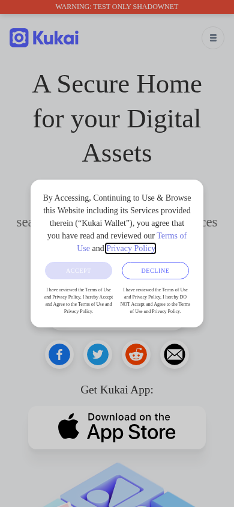
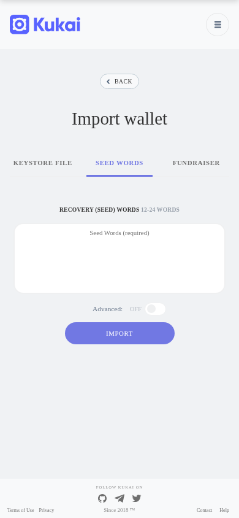

# Inherited web wallet UX review

On 24 November 2026 a keyboard user could reach the next step in wallet creation without being able to reveal the recovery phrase. The covered phrase was already present in Chromium's accessibility tree. Start the handover with seed handling, import and dialog focus. The review tracker contains each reproduction and its retest. [Findings and owner decisions](https://github.com/dvkam/kukai/issues/55)

## Reproduce the review

Check out `a299e7b36bc773ed4724d3abcf1a70a751e1dbb1`, install the locked dependencies and run `node node_modules/@angular/cli/bin/ng serve --configuration development`. Open localhost in a disposable Chromium profile. Allow local assets and block external HTTP requests for the offline cases. This also blocks external fonts. The screenshots show fallback fonts. Use simulated assets only. Keep phrases, passwords and keystores out of screenshots, traces and bug reports.

The review used Chromium 156.0.8078.79 on Linux. The route walk used 1280, 390 and 320 by 844 CSS pixels. The short mobile menu test used 390 by 650. The reviewer compared rendered screens, tab order, computed styles and the accessibility tree. For the account paths the reviewer created a disposable wallet through the UI, verified its words, downloaded its keystore, opened the account and discarded the profile. The development build used Shadownet settings. Browser emulation covers layout and input behavior here. Physical iPhone, WebKit, VoiceOver, live providers, a connected Ledger, participant studies and the future native app still need their own runs.

## Findings and where to fix them

Use the IDs in issue #55 to record a fixing PR, tested revision, reviewer and result. High means a user can lose access to a task or encounter sensitive content before asking for it. Medium means the user loses feedback, orientation or a recovery path. The motion observation is a design requirement.

| ID | Impact and reproduction on the baseline | Acceptance check and source |
| --- | --- | --- |
| U1, high | On fresh Home, Tab five times. The desktop logo, three wallet links and Google receive focus behind the agreement. Decline navigates to a blank page. | Keep focus inside a named agreement. Both choices must be operable. Declining must leave an explanation and route back without accepting. See `views/start/agreement/agreement.component.html`. |
| U2, high | On /new-wallet, Tab skips the seed cover and reaches Next. Before reveal, the accessibility snapshot includes all 24 generated words. | Keep the phrase out of rendered text until requested. Use a keyboard-operable reveal and hide action. Verify the snapshot changes without recording the words. See `new-wallet.component.html`. |
| U3, high | On /import, Tab visits both the Back link and its nested button, then leaves the card. Method tabs have click handlers only. Browse labels a hidden file input. | Select and validate each method without a pointer. Back should have one stop. Verify tab selection, field names and file-dialog cancellation. See `mnemonic-import.component.html`. |
| U4, high | At 390 by 650, open and close the hamburger on Home. Escape leaves it open. Pointer dismissal leaves body overflow hidden. Wheel input leaves scrollTop at zero on a 1193 px page. | Open and dismiss by keyboard, touch, outside click and route change. Preserve previous scrolling and restore focus when the invoker remains. See `mobile-menu.component.ts` and `dropdown.component.ts`. |
| U5, high | In a disposable account, click the header QR icon. Receive opens with focus on BODY. Escape leaves it open. Tab reaches Settings and then actions behind the dialog. The close control is a div. | Give Receive a name, initial focus, reachable Copy and Close, and focus return. Check each account dialog, including Send. Never interpret dismissal of a signing prompt as approval. See `receive.component.html`, `modal.component.ts` and `prepare-send.component.html`. |
| U6, medium | Import a bad.tez containing only an opening brace. A temporary message shows a JavaScript SyntaxError. There is no alert or live region. | Show an actionable message beside Browse, announce it once and allow another file. See `mnemonic-import.component.ts` and `modals/alert/alert.component.html`. |
| U7, high | On Home, the four social provider images have no keyboard stop. In Balances, inspect Send before hover. Its accessibility snapshot contains an unnamed button and image. | Give every action a stable accessible name and keyboard activation. Retest before hover, with touch and in the accessible tree. See `start.component.html` and `send-button.component.html`. |
| U8, medium | Enter an unknown route and then /500 directly. Both error panels contain zero links and zero buttons. The global logo links home. | Provide an explicit safe destination. Offer retry only for a known safe operation. Test with empty browser history. See `views/error/404.component.html` and `500.component.html`. |
| U9, medium | On mobile Fundraiser import, four inputs have no associated label elements. Computed text size is 10.8 CSS px. The viewport requests a maximum scale of one. | Associate labels and field errors, allow zoom, test at 200% and with the iPhone keyboard open. See `src/index.html` and `mnemonic-import.component.html`. |
| U10, design | Open the mobile menu. Its panel switches display immediately. Its computed transform origin is in the middle. In the account picker CSS the arrow rotates while the list switches display. | Anchor entries and exits to the invoking control. Test the panel as well as the icon. See the inventory below and `src/scss/components/ui/dropdown/`. |
| U11, medium | Enable reduced motion before first load. The Accept button still has a 750 ms fade. | Both agreement actions should be readable and usable immediately in reduced motion. Check a fresh visit in both modes. See `agreement.component.scss`. |
| U12, medium | With external requests blocked, open a new wallet, visit Settings and return. After 31 seconds Recent Activity still says "Loading activity..." without retry. | Distinguish loading, confirmed empty, stale and unreachable. Recover on retry without changing account. See `account-view/activity/activity.component.html`. |

Two further keyboard checks failed on the same forms. In Fundraiser import, focus Email, press Tab and type a dummy password. The password field stays read-only and empty. Clicking it enables entry. Retest U3 through password entry and remove the pointer-only unlock in `mnemonic-import.component.ts`. On /connect-ledger, the "Custom derivation path" switch exposes only text in the accessibility tree, leaving the path disabled. Use a named switch with keyboard operation and check the same Advanced component on seed import. These cases are part of U3 in the tracker.

Two controls did provide a way forward. Fundraiser activation rejected a blank address. Back returned to the Fundraiser method. Send Preview rejected an empty recipient in the local account. These checks cover invalid input. No transaction was signed or broadcast.

## Interaction and motion handover

For any menu, picker, tooltip, disclosure, sheet or dialog launched by a control, use that control as the origin. A dialog launched from a button follows this rule even when its final position is at the viewport center. Keep the backdrop still. If a provider sends a request without an invoker, use a named prompt with its own focus target. Do not borrow the last button the user touched.

| Family | Examples in the inherited wallet | What to check |
| --- | --- | --- |
| Navigation and pickers | Mobile hamburger, account selector, session and permission account selectors, prepare-send asset list, swap options | Open the same panel from each available invoker. Check opening and closing on both sides of a placement flip. Recalculate after scroll or resize. Reverse quickly and confirm the final state. |
| Account and asset dialogs | Receive QR from header or mobile menu, account list, token details, new account, Send, buy, swap, delegation and settings backup | Animate the content from the invoking control. Keep overlay geometry and hit testing stable. Test close, route changes, nested dialogs and an invoker that disappears. Return focus to its logical successor when necessary. |
| Inline disclosures and hover help | Import Advanced, custom Ledger path, fee details, account action tooltips, asset actions and chart values | Expand at the row or point that requested more information. Open help on focus as well as hover. Keep repeated keyboard interactions immediate. Offer equivalent information on touch. |
| Prompts without a local trigger | First-run consent, service status, incoming dApp permission/sign requests and embedded requests | Show the reason and caller. Give the dialog initial focus and explicit safe dismissal where permitted. Do not animate from an unrelated pointer position. |

Use transform and opacity on the panel. Prefer a short interruptible transition. With reduced motion, remove spatial movement. Never delay input or dismissal for an animation. Test normal and reduced motion, focus return, scrolling, resize, rapid reversals, touch and keyboard. A frame-rate or V8 optimization claim requires a recording and a matching uninstrumented timing run. [Performance tracker](https://github.com/dvkam/kukai/issues/52)

## Component contracts for the next handover

Start with a menu trigger, dialog, file picker and inline error. Document when each applies, who owns its open state, keyboard and focus behavior, and one working caller. Give components strict Angular inputs and outputs or strict props on the chosen v1 web stack. A disclosure needs an accessible name and expanded state. A modal needs a title, close behavior and an explicit invoker or a documented external entry. Keep color and motion roles in semantic tokens such as text-danger, focus-ring, surface-dialog and motion-panel-enter. Check the roles in both themes.

Have CI compile representative consumer templates and lint external HTML. Include an intentionally invalid consumer and assert the expected diagnostic, alongside a passing example. Cover missing names, invalid variants, broken token references and illegal state combinations at the layer that can detect them. Add interaction tests for focus, cancellation and reduced motion. The inherited TypeScript lint command alone does not check these template contracts. [Component quality](https://github.com/dvkam/kukai/issues/54) · [Recurring UX review](https://github.com/dvkam/kukai/issues/53)

Re-run these flows with signed test fixtures, slow and restored network, long account names, unknown token values, screen readers and physical devices as those become available. Validate recovery and unilateral exit on the proposed wallet separately. Those flows have their own acceptance evidence. [Release 1 definition of done](../v1-done.md)

Review references include Emil Kowalski's design engineering, break-ui, mobile-native, animation performance and animation review standards. The public sources were available in this environment. [Emil's skills at the reviewed revision](https://github.com/emilkowalski/skills/tree/64eb3deb9a5fbfa041faf783e0bc3fd635872e9c/skills)
